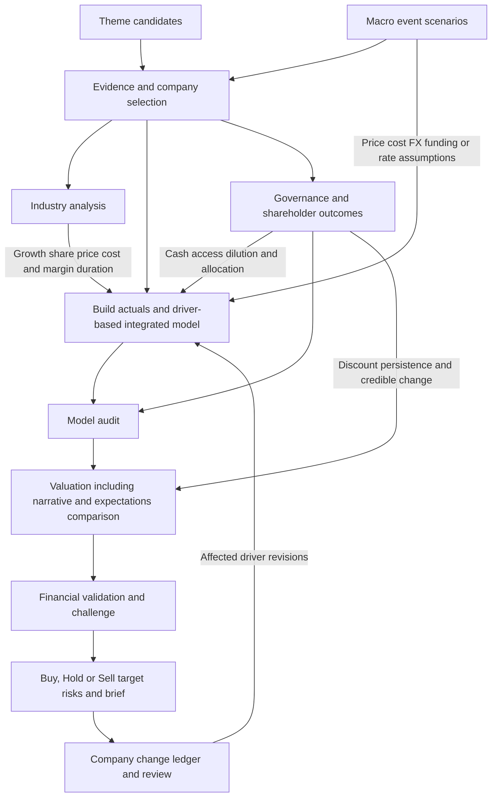

# Optional research branches

For company research, first select initiation, regular review or major earnings/catalyst update through [request routing](request-routing.md). The branches below support the selected mode; they do not bypass its baseline, evidence or forecast-learning requirements.

Use a specialist directly for a focused request, or incorporate its findings into a full cycle when they can change the decision. These branches extend the model-first company workflow. Their appearance or order in this catalog does not rank their importance. Use the [shared materiality principle](underwriting-standard.md#integrate-the-analysis-by-materiality); a proportionate context scan in full research is distinct from a standalone theme or macro deep dive.

| Branch | Entry point | Result and downstream use |
| --- | --- | --- |
| [Fundamental/theme screening](../../theme-screening/SKILL.md) | After initial evidence, before company selection | Defined financial screen or chain/peer map, comparable first pass, shortlist and next decisive question → selected company models |
| [Macro event analysis](../../macro-event-analysis/SKILL.md) | After event verification; revisit at material shocks | Causal/scenario map → company drivers, valuation rates and research scenarios |
| [Narrative/valuation analysis](../../valuation-thesis/SKILL.md) | Current price-implied work within the existing valuation stage after model audit; historical work after point-in-time evidence assembly | Conditional expectations map → financial validation/challenge; historical work → learning hypotheses |
| [Company change tracking](../../company-change-tracking/SKILL.md) | At an update/review or after new disclosure | Comparable evidence chain → affected model nodes → recalculation, audit and refreshed valuation/conclusion |
| [Financial review](../../financial-quality/SKILL.md) | Model audit, post-valuation validation or standalone account/filing question | Account coverage, cash bridges and explanation tests → model constraints and thesis support/refutation |
| [Industry analysis](../../industry-analysis/SKILL.md) | Required in full company research before operating forecasts; refreshed in every review; also usable for a standalone industry question (`industry-review` route) | Market and value chain, growth, niche, barrier trend, upstream costs and downstream behaviour → growth, share, price, cost and margin-duration assumptions, the target multiple and tracking indicators |
| [Corporate governance](../../corporate-governance/SKILL.md) | Required in full company research before forecasts; also usable as a focused review | Control/rights, conduct and allocation → model/value consequences, persistent-discount or improvement case → thesis validation and conclusion |
| [Opinion challenge](../../research-challenge/SKILL.md) | Standalone opinion or pre-conclusion check | Claim-level fact tests and counter-case → targeted rework |

Fundamental screens reuse the `theme-discovery` catalog route with the screening specialist's financial mode; they need no invented theme or new mandatory company stage. Sector leadership/rotation reuses `macro-event-review` in current-regime mode. Historical anchor/entry replays reuse `historical-narrative-review`; portfolio strategy testing remains outside this module. Durable recurring work reuses `recurring-review`.

## Company route with optional inputs

## Agent handoffs

Keep large evidence ledgers, scenario maps and numerical results in referenced structured datasets; use the [handoff envelope](handoffs.md) for identity, sources, claims, dependencies, checks and next actions. A documented record or proposed review condition does not establish that a storage service, scheduler or monitor is running.

Stable company/metric/period IDs link new observations to the executable model. A supported revision creates a new model/evidence vintage and recomputes affected outputs; dependent valuations and conclusions become stale until refreshed. Preserve frozen forecasts and prior decisions for learning. A thematic rating, keyword statistic, event narrative or return attribution must not silently become a model input or trading signal.

Catalog discovery routes cover theme, macro, historical narrative, company-change and recurring company review. They can end in useful partial analysis and a brief. Selecting a theme candidate or identifying a material change resumes the relevant company stages; the short discovery routes do not imply that a company recommendation has passed the full cycle.
